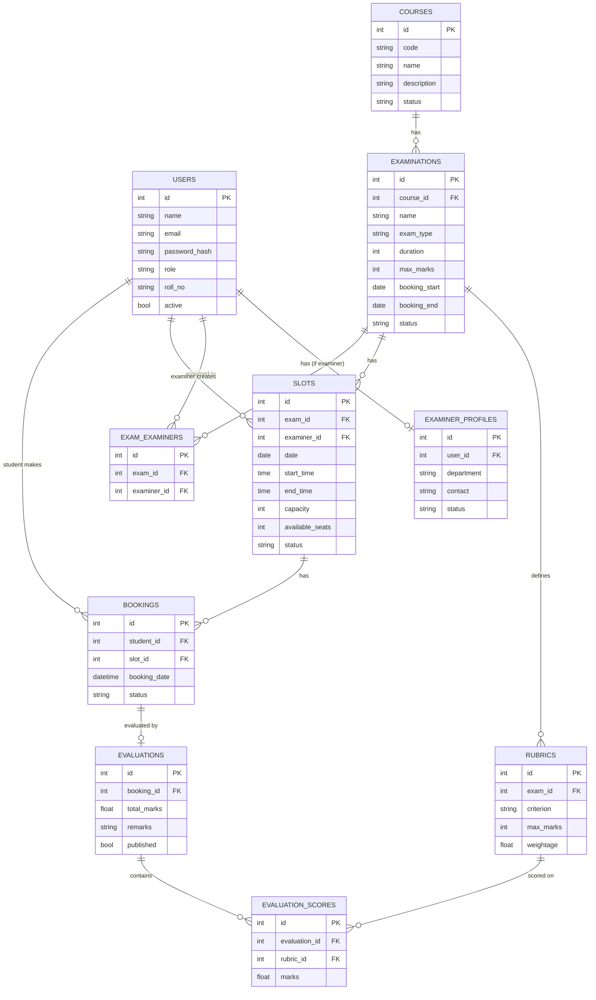

# Examination Management Portal (EMP) — Complete Beginner Roadmap

> MAD-I project. Stack allowed: **Flask + Jinja2 + HTML + CSS + Bootstrap + SQLite**. Nothing else for core features.
> Rules to remember: **no JavaScript for core features**, database must be **created by code**, admin must be **seeded by a Python script**, Bootstrap is the **only** CSS framework.

---

## 0. First, the direct answer to "what do I design first?"

**Do NOT jump to Flask. Do NOT jump to the database tables either.** The correct order is:

```
1. Understand the problem   (who are the users, what can each one do)
2. Write the list of pages  (page map / flow on paper)
3. Design the ER diagram    (tables + relationships)   <-- DATABASE DESIGN FIRST
4. Rough wireframes         (simple boxes on paper)
5. Project skeleton         (folders + empty Flask app)
6. models.py                (turn ER diagram into code)
7. Authentication           (register / login / roles)
8. Admin -> Examiner -> Student features, one by one
9. Rules & history          (overbooking, windows, status tracking)
10. Testing, report, video, ZIP, viva prep
```

Reason: a website is just *forms + tables + rules on top of a database*. If the ER diagram is right, everything else becomes easy. If it is wrong, you rewrite everything later. So: **paper → ER diagram → models → pages**.

---

## 1. Timeline (today is 2 Nov 2026)

| When | What | Milestone |
|---|---|---|
| Day 1–2 | Install tools, create GitHub repo, README, push | **Milestone 0 (deadline 17 Nov 2026)** — finish early, it's easy |
| Day 1–7 | Watch basics (Python, HTML/CSS, Git, Flask) — in parallel with the steps below | – |
| Day 3–5 | Requirements, page map, **ER diagram**, wireframes | – |
| Day 6–10 | Skeleton + `models.py` + seed admin | Database Models |
| Day 11–14 | Register/login/role-based dashboards | Authentication |
| Day 15–22 | Admin features | Admin Dashboard |
| Day 23–28 | Examiner features | Examiner Dashboard |
| Day 29–35 | Student features | Student Dashboard |
| Day 36–40 | Rules, history, evaluation tracking | Booking History & Evaluation |
| Day 41–45 | Testing, optional features, report, video, ZIP | Submission |

Check your portal for the real final deadline and shift this table accordingly. The core milestones can be done in any order, but the order above is the easiest.

---

## 2. Tools to install (Step 1)

1. **Python 3.10+** — https://www.python.org/downloads/ (tick "Add to PATH" on Windows)
2. **VS Code** — https://code.visualstudio.com/ (extensions: *Python*, *Jinja*, *SQLite Viewer*)
3. **Git** — https://git-scm.com/downloads
4. **GitHub account** — https://github.com
5. Drawing tools for the ER diagram (pick one): https://dbdiagram.io, https://app.diagrams.net (draw.io), or just a notebook.

> Do **not** use DB Browser to create tables (not allowed). You may use it only to *view* data. The VS Code "SQLite Viewer" extension is enough.

---

## 3. Milestone 0 — GitHub setup (do this first, takes 1 hour)

```bash
# 1. Make the project folder
mkdir emp && cd emp

# 2. Virtual environment (keeps libraries separate)
python -m venv venv
# Windows:   venv\Scripts\activate
# Linux/WSL/Mac:  source venv/bin/activate

# 3. Git
git init
```

Create these files:

**README.md**
```markdown
# Examination Management Portal (EMP)
Flask + SQLite web app where Admin, Examiners and Students manage exam slots, bookings and evaluations.
```

**.gitignore**
```
venv/
__pycache__/
*.pyc
instance/
*.db
.env
```

Then on github.com → New repository → **Private** → copy the URL:

```bash
git add .
git commit -m "Milestone-0 EMP-MAD-1"
git branch -M main
git remote add origin https://github.com/<your-username>/<repo>.git
git push -u origin main
```

Finally: GitHub repo → Settings → Collaborators → add **MADI-cs2003** (the doc says requests are accepted after term starts).

---

## 4. Learning plan (do alongside the work)

You don't need to learn everything first. Learn in this order, just-in-time:

| Need | What to learn | Time |
|---|---|---|
| Python | functions, lists, dicts, classes, `if/for` | 2–3 days |
| Git | `add`, `commit`, `push` | 1 hour |
| HTML/CSS | forms, tables, links, basic layout | 2 days |
| Bootstrap 5 | navbar, cards, tables, forms, grid, alerts | 1 day |
| Flask | routes, templates, forms, sessions, blueprints | 4–5 days |
| Jinja2 | `{{ }}`, ``, ``, template inheritance | 1 day |
| SQLAlchemy | models, relationships, queries | 2 days |
| ER diagram | entities, PK/FK, 1-1, 1-N, N-N | 3 hours |

### 4.1 Hindi resources (preferred)

I could verify these pages exist; open them and play the lectures from there. (I did not copy individual video IDs, so I'm giving course pages / search links so nothing is broken.)

- **Flask (Hindi) — CodeWithHarry "Web Development Using Flask and Python"** (covers how websites work, first app, static/templates, Bootstrap site, Jinja, Flask-SQLAlchemy, admin dashboard, edit/delete, pagination, flash messages, REST APIs):
  https://classcentral.com/course/youtube-hindi-web-development-using-flask-and-python-54771
- **Flask (Hindi) — CodeWithHarry "Python Flask Web Development Tutorial"** (22 short lectures: install, virtual environment, minimal app, templates, SQLAlchemy To-Do app with CRUD, template inheritance):
  https://classcentral.com/course/youtube-python-flask-web-development-tutorial-in-hindi-137216
- **Hindi course directory** (Python, Git, Web Dev, Flask lists by channel — look for *CodeWithHarry*, *Apna College*, *Harshit Vashisth*):
  https://github.com/wacmx/free-programming-books/blob/main/courses/free-courses-hi.md
- **Python (Hindi):** https://www.youtube.com/results?search_query=python+tutorial+for+beginners+hindi+codewithharry
- **Git & GitHub (Hindi):** https://www.youtube.com/results?search_query=git+and+github+tutorial+hindi+codewithharry
- **HTML + CSS + Web dev (Hindi):** https://www.youtube.com/results?search_query=web+development+course+hindi+html+css+apna+college
- **Bootstrap 5 (Hindi):** https://www.youtube.com/results?search_query=bootstrap+5+tutorial+in+hindi
- **ER diagram / DBMS (Hindi):** https://www.youtube.com/results?search_query=er+diagram+in+dbms+hindi+gate+smashers
- **SQL basics (Hindi):** https://www.youtube.com/results?search_query=sql+tutorial+hindi
- **Flask-SQLAlchemy relationships (Hindi):** https://www.youtube.com/results?search_query=flask+sqlalchemy+relationship+one+to+many+hindi
- **Flask-Login (Hindi):** https://www.youtube.com/results?search_query=flask+login+logout+register+hindi

### 4.2 English resources

- Your own course lectures: https://www.youtube.com/results?search_query=Modern+Application+Development+I+IIT+Madras
- Flask docs (read the Quickstart + Tutorial): https://flask.palletsprojects.com/
- Flask-SQLAlchemy: https://flask-sqlalchemy.palletsprojects.com/
- Flask-Login: https://flask-login.readthedocs.io/
- Jinja2 templates: https://jinja.palletsprojects.com/
- Bootstrap 5 docs: https://getbootstrap.com/docs/5.3/
- SQLite: https://www.sqlite.org/docs.html
- Mermaid ER diagrams (live editor): https://mermaid.live

---

## 5. Step 2 — Understand users & write the page map (on paper, 2–3 hours)

### Roles
- **Admin** — pre-created, controls everything.
- **Examiner** — registers, needs admin approval, creates slots, evaluates.
- **Student** — registers, books slots, sees results.

### Page map (each line = one Flask route + one HTML template)

**Public:** `/` home, `/login`, `/register/student`, `/register/examiner`, `/logout`

**Admin** (`/admin/...`): dashboard, courses (list/add/edit/delete), exams (list/add/edit/delete/timeline), rubrics (per exam), examiners (list/approve/deactivate/add), students (list), slots (list + change examiner), bookings (list + reschedule), search, history

**Examiner** (`/examiner/...`): dashboard, profile, my exams, slots (list/add/edit/delete), booked students per slot, evaluate (rubric form), pending evaluations

**Student** (`/student/...`): dashboard, profile, exams (search/filter), slots of an exam, book, my bookings (cancel), history, results

---

## 6. Step 3 — ER Diagram (design BEFORE any code)

### 6.1 How to think
1. List the **nouns** in the problem statement → these become tables (User, Course, Examination, Rubric, Slot, Booking, ...).
2. For each, list its **fields** (the doc already gives most).
3. Decide **relationships**:
   - **1-to-many**: one Course has many Examinations. → put `course_id` (foreign key) in Examination.
   - **many-to-many**: an Examination can have many examiners and an examiner many exams → needs a **middle table**.
4. Mark **PK** (primary key) and **FK** (foreign key).

### 6.2 Recommended tables (simple and sufficient)

| Table | Important columns |
|---|---|
| `users` | id PK, name, email (unique), password_hash, role (`admin`/`examiner`/`student`), phone, roll_no, active, created_at |
| `examiner_profiles` | id PK, user_id FK (unique), department, contact, employee_id, status (`Pending`/`Approved`/`Deactivated`) |
| `courses` | id PK, code (unique), name, description, status (`Active`/`Inactive`) |
| `examinations` | id PK, course_id FK, name, exam_type, duration_min, max_marks, slot_creation_start, slot_creation_end, booking_start, booking_end, slot_creation_open (bool), booking_open (bool), status |
| `exam_examiners` | id PK, exam_id FK, examiner_id FK (who is assigned to which exam) |
| `rubrics` | id PK, exam_id FK, criterion, max_marks, weightage, description |
| `slots` | id PK, exam_id FK, examiner_id FK, date, start_time, end_time, capacity, available_seats, status |
| `bookings` | id PK, student_id FK, slot_id FK, booking_date, status (`Booked`/`Cancelled`/`Completed`) |
| `evaluations` | id PK, booking_id FK (unique), total_marks, remarks, published (bool), evaluated_at |
| `evaluation_scores` | id PK, evaluation_id FK, rubric_id FK, marks |

### 6.3 ER diagram (paste this in https://mermaid.live to see it; GitHub also renders it)



Draw the same thing cleanly in dbdiagram.io or draw.io — **you must put this picture in your report**.

---

## 7. Step 4 — Wireframes (1 hour)

On paper, draw each main page as boxes: navbar on top, a table or form in the middle. Don't care about beauty. Example for the Student dashboard:

```
+--------------------------------------------------+
| EMP   Dashboard | Exams | My Bookings | Results   Logout |
+--------------------------------------------------+
| [Available Exams: 4] [Upcoming: 1] [Booked: 2]   |   <- Bootstrap cards
| Upcoming examinations (table)                    |
| Published results (table)                        |
+--------------------------------------------------+
```

Every page gets the same navbar from `base.html` (see Step 9).

---

## 8. Step 5 — Project skeleton (create files in this order)

```
emp/
├── app.py                  # create_app(), registers blueprints, creates DB + admin
├── config.py               # SECRET_KEY, database URI
├── extensions.py           # db, login_manager
├── models.py               # all tables
├── decorators.py           # role_required
├── init_db.py              # (optional) run once to reset DB + seed admin
├── requirements.txt
├── README.md
├── routes/
│   ├── __init__.py
│   ├── auth.py             # register, login, logout
│   ├── admin.py
│   ├── examiner.py
│   ├── student.py
│   └── api.py              # optional JSON API
├── templates/
│   ├── base.html
│   ├── home.html
│   ├── auth/  login.html  register_student.html  register_examiner.html
│   ├── admin/ dashboard.html courses.html course_form.html exams.html exam_form.html rubrics.html examiners.html students.html slots.html bookings.html reschedule.html search.html
│   ├── examiner/ dashboard.html profile.html slots.html slot_form.html slot_students.html evaluate.html
│   └── student/ dashboard.html profile.html exams.html exam_slots.html bookings.html history.html results.html
└── static/css/style.css
```

**Create files in this order:** `config.py` → `extensions.py` → `models.py` → `app.py` → `decorators.py` → `routes/auth.py` → `templates/base.html` + auth templates → `routes/admin.py` + admin templates → examiner → student.

Install libraries:

```bash
pip install flask flask-sqlalchemy flask-login
pip freeze > requirements.txt
```

(Flask-Login / Flask-SQLAlchemy are Flask extensions; the project document itself recommends Flask-Login.)

### config.py
```python
import os
BASE_DIR = os.path.abspath(os.path.dirname(__file__))

class Config:
    SECRET_KEY = os.environ.get("SECRET_KEY", "change-this-in-real-life")
    SQLALCHEMY_DATABASE_URI = "sqlite:///" + os.path.join(BASE_DIR, "emp.db")
    SQLALCHEMY_TRACK_MODIFICATIONS = False
```

### extensions.py
```python
from flask_sqlalchemy import SQLAlchemy
from flask_login import LoginManager

db = SQLAlchemy()
login_manager = LoginManager()
login_manager.login_view = "auth.login"
login_manager.login_message_category = "warning"
```

---

## 9. Step 6 — models.py (ER diagram → code)

```python
from datetime import datetime, date
from flask_login import UserMixin
from werkzeug.security import generate_password_hash, check_password_hash
from extensions import db, login_manager


class User(UserMixin, db.Model):
    __tablename__ = "users"
    id = db.Column(db.Integer, primary_key=True)
    name = db.Column(db.String(100), nullable=False)
    email = db.Column(db.String(120), unique=True, nullable=False)
    password_hash = db.Column(db.String(255), nullable=False)
    role = db.Column(db.String(20), nullable=False)        # admin / examiner / student
    phone = db.Column(db.String(20))
    roll_no = db.Column(db.String(30))                     # students
    active = db.Column(db.Boolean, default=True)
    created_at = db.Column(db.DateTime, default=datetime.utcnow)

    examiner_profile = db.relationship("ExaminerProfile", backref="user", uselist=False)
    bookings = db.relationship("Booking", backref="student")

    def set_password(self, pw):  self.password_hash = generate_password_hash(pw)
    def check_password(self, pw): return check_password_hash(self.password_hash, pw)

    @property
    def is_active(self):          # used by Flask-Login
        return self.active


@login_manager.user_loader
def load_user(user_id):
    return db.session.get(User, int(user_id))


class ExaminerProfile(db.Model):
    __tablename__ = "examiner_profiles"
    id = db.Column(db.Integer, primary_key=True)
    user_id = db.Column(db.Integer, db.ForeignKey("users.id"), unique=True, nullable=False)
    department = db.Column(db.String(100))
    contact = db.Column(db.String(50))
    employee_id = db.Column(db.String(30))
    status = db.Column(db.String(20), default="Pending")   # Pending / Approved / Deactivated


class Course(db.Model):
    __tablename__ = "courses"
    id = db.Column(db.Integer, primary_key=True)
    code = db.Column(db.String(20), unique=True, nullable=False)
    name = db.Column(db.String(150), nullable=False)
    description = db.Column(db.Text)
    status = db.Column(db.String(20), default="Active")
    exams = db.relationship("Examination", backref="course")


class Examination(db.Model):
    __tablename__ = "examinations"
    id = db.Column(db.Integer, primary_key=True)
    course_id = db.Column(db.Integer, db.ForeignKey("courses.id"), nullable=False)
    name = db.Column(db.String(150), nullable=False)
    exam_type = db.Column(db.String(30), nullable=False)   # Viva / Practical / Project Demo / Assessment
    duration = db.Column(db.Integer, nullable=False)       # minutes
    max_marks = db.Column(db.Integer, nullable=False)
    slot_creation_start = db.Column(db.Date)
    slot_creation_end = db.Column(db.Date)
    booking_start = db.Column(db.Date)
    booking_end = db.Column(db.Date)
    slot_creation_open = db.Column(db.Boolean, default=False)   # admin toggle
    booking_open = db.Column(db.Boolean, default=False)         # admin toggle
    status = db.Column(db.String(20), default="Draft")  # Draft/Slot Creation/Booking Open/Closed/Completed

    rubrics = db.relationship("Rubric", backref="exam", cascade="all, delete-orphan")
    slots = db.relationship("Slot", backref="exam")
    assignments = db.relationship("ExamExaminer", backref="exam", cascade="all, delete-orphan")

    # ---- rule helpers (used in routes) ----
    def slot_creation_allowed(self):
        t = date.today()
        return (self.slot_creation_open and self.slot_creation_start and self.slot_creation_end
                and self.slot_creation_start <= t <= self.slot_creation_end)

    def booking_allowed(self):
        t = date.today()
        return (self.booking_open and self.booking_start and self.booking_end
                and self.booking_start <= t <= self.booking_end)

    def booking_started(self):
        return bool(self.booking_open) or (self.booking_start and date.today() >= self.booking_start)


class ExamExaminer(db.Model):
    __tablename__ = "exam_examiners"
    id = db.Column(db.Integer, primary_key=True)
    exam_id = db.Column(db.Integer, db.ForeignKey("examinations.id"), nullable=False)
    examiner_id = db.Column(db.Integer, db.ForeignKey("users.id"), nullable=False)
    examiner = db.relationship("User")


class Rubric(db.Model):
    __tablename__ = "rubrics"
    id = db.Column(db.Integer, primary_key=True)
    exam_id = db.Column(db.Integer, db.ForeignKey("examinations.id"), nullable=False)
    criterion = db.Column(db.String(150), nullable=False)
    max_marks = db.Column(db.Float, nullable=False)
    weightage = db.Column(db.Float, default=1.0)
    description = db.Column(db.Text)


class Slot(db.Model):
    __tablename__ = "slots"
    id = db.Column(db.Integer, primary_key=True)
    exam_id = db.Column(db.Integer, db.ForeignKey("examinations.id"), nullable=False)
    examiner_id = db.Column(db.Integer, db.ForeignKey("users.id"), nullable=False)
    date = db.Column(db.Date, nullable=False)
    start_time = db.Column(db.Time, nullable=False)
    end_time = db.Column(db.Time, nullable=False)
    capacity = db.Column(db.Integer, nullable=False)
    available_seats = db.Column(db.Integer, nullable=False)
    status = db.Column(db.String(20), default="Available")   # Available/Full/Cancelled/Completed

    examiner = db.relationship("User", foreign_keys=[examiner_id])
    bookings = db.relationship("Booking", backref="slot")


class Booking(db.Model):
    __tablename__ = "bookings"
    id = db.Column(db.Integer, primary_key=True)
    student_id = db.Column(db.Integer, db.ForeignKey("users.id"), nullable=False)
    slot_id = db.Column(db.Integer, db.ForeignKey("slots.id"), nullable=False)
    booking_date = db.Column(db.DateTime, default=datetime.utcnow)
    status = db.Column(db.String(20), default="Booked")      # Booked/Cancelled/Completed
    evaluation = db.relationship("Evaluation", backref="booking", uselist=False)


class Evaluation(db.Model):
    __tablename__ = "evaluations"
    id = db.Column(db.Integer, primary_key=True)
    booking_id = db.Column(db.Integer, db.ForeignKey("bookings.id"), unique=True, nullable=False)
    total_marks = db.Column(db.Float, default=0)
    remarks = db.Column(db.Text)
    published = db.Column(db.Boolean, default=False)
    evaluated_at = db.Column(db.DateTime, default=datetime.utcnow)
    scores = db.relationship("EvaluationScore", backref="evaluation", cascade="all, delete-orphan")


class EvaluationScore(db.Model):
    __tablename__ = "evaluation_scores"
    id = db.Column(db.Integer, primary_key=True)
    evaluation_id = db.Column(db.Integer, db.ForeignKey("evaluations.id"), nullable=False)
    rubric_id = db.Column(db.Integer, db.ForeignKey("rubrics.id"), nullable=False)
    marks = db.Column(db.Float, nullable=False)
    rubric = db.relationship("Rubric")
```

> Note: no `unique` constraint on (student, slot) in `Booking` on purpose — a student who cancelled may book again. The "no duplicate booking for the same exam" rule is enforced in code (Step 14).

---

## 10. Step 7 — app.py (creates DB + admin programmatically)

```python
from flask import Flask, render_template, redirect, url_for
from flask_login import current_user
from config import Config
from extensions import db, login_manager
from models import User


def seed_admin():
    """Admin is pre-created via code. No admin registration page exists."""
    if not User.query.filter_by(role="admin").first():
        admin = User(name="Administrator", email="admin@emp.com", role="admin")
        admin.set_password("admin123")      # change before demo if you want
        db.session.add(admin)
        db.session.commit()


def create_app():
    app = Flask(__name__)
    app.config.from_object(Config)
    db.init_app(app)
    login_manager.init_app(app)

    from routes.auth import auth_bp
    from routes.admin import admin_bp
    from routes.examiner import examiner_bp
    from routes.student import student_bp
    app.register_blueprint(auth_bp)
    app.register_blueprint(admin_bp, url_prefix="/admin")
    app.register_blueprint(examiner_bp, url_prefix="/examiner")
    app.register_blueprint(student_bp, url_prefix="/student")

    with app.app_context():
        db.create_all()      # tables created by code
        seed_admin()

    @app.route("/")
    def home():
        if current_user.is_authenticated:
            return redirect(url_for("auth.dashboard_redirect"))
        return render_template("home.html")

    return app


if __name__ == "__main__":
    create_app().run(debug=True)
```

Create empty blueprint files first so the import doesn't fail (e.g. in `routes/admin.py`):

```python
from flask import Blueprint
admin_bp = Blueprint("admin", __name__)
```
(Same for `examiner_bp`, `student_bp`.) Also create an empty `routes/__init__.py`.

Run: `python app.py` → open http://127.0.0.1:5000 → `emp.db` appears automatically. 

Commit: `git commit -m "DB models and schema setup - EMP"`

---

## 11. Step 8 — decorators.py (role-based access)

```python
from functools import wraps
from flask import abort
from flask_login import current_user, login_required


def role_required(role):
    def decorator(f):
        @wraps(f)
        @login_required
        def wrapper(*args, **kwargs):
            if current_user.role != role:
                abort(403)
            if role == "examiner":
                p = current_user.examiner_profile
                if not p or p.status != "Approved":
                    abort(403)
            return f(*args, **kwargs)
        return wrapper
    return decorator
```

---

## 12. Step 9 — Authentication (routes/auth.py)

```python
from flask import Blueprint, render_template, request, redirect, url_for, flash
from flask_login import login_user, logout_user, login_required, current_user
from extensions import db
from models import User, ExaminerProfile

auth_bp = Blueprint("auth", __name__)


@auth_bp.route("/register/student", methods=["GET", "POST"])
def register_student():
    if request.method == "POST":
        name = request.form["name"].strip()
        email = request.form["email"].strip().lower()
        pw = request.form["password"]
        if not name or not email or len(pw) < 6:
            flash("Fill all fields; password must be at least 6 characters.", "danger")
        elif User.query.filter_by(email=email).first():
            flash("Email already registered.", "danger")
        else:
            u = User(name=name, email=email, role="student", roll_no=request.form.get("roll_no"))
            u.set_password(pw)
            db.session.add(u); db.session.commit()
            flash("Registered! Please log in.", "success")
            return redirect(url_for("auth.login"))
    return render_template("auth/register_student.html")


@auth_bp.route("/register/examiner", methods=["GET", "POST"])
def register_examiner():
    if request.method == "POST":
        email = request.form["email"].strip().lower()
        if User.query.filter_by(email=email).first():
            flash("Email already registered.", "danger")
        else:
            u = User(name=request.form["name"].strip(), email=email, role="examiner")
            u.set_password(request.form["password"])
            db.session.add(u); db.session.flush()           # gets u.id
            db.session.add(ExaminerProfile(user_id=u.id,
                           department=request.form.get("department"),
                           contact=request.form.get("contact"),
                           status="Pending"))
            db.session.commit()
            flash("Registered. Wait for admin approval before logging in.", "info")
            return redirect(url_for("auth.login"))
    return render_template("auth/register_examiner.html")


@auth_bp.route("/login", methods=["GET", "POST"])
def login():
    if request.method == "POST":
        user = User.query.filter_by(email=request.form["email"].strip().lower()).first()
        if not user or not user.check_password(request.form["password"]):
            flash("Invalid email or password.", "danger")
        elif not user.active:
            flash("Account deactivated.", "danger")
        elif user.role == "examiner" and user.examiner_profile.status != "Approved":
            flash("Your account is %s. Admin approval required." % user.examiner_profile.status, "warning")
        else:
            login_user(user)
            return redirect(url_for("auth.dashboard_redirect"))
    return render_template("auth/login.html")


@auth_bp.route("/go")
@login_required
def dashboard_redirect():
    return redirect(url_for({"admin": "admin.dashboard",
                             "examiner": "examiner.dashboard",
                             "student": "student.dashboard"}[current_user.role]))


@auth_bp.route("/logout")
@login_required
def logout():
    logout_user()
    flash("Logged out.", "info")
    return redirect(url_for("home"))
```

### templates/base.html (every page extends this)

```html
<!doctype html>
<html lang="en">
<head>
  <meta charset="utf-8">
  <meta name="viewport" content="width=device-width, initial-scale=1">
  <title>EMP</title>
  <link href="https://cdn.jsdelivr.net/npm/bootstrap@5.3.3/dist/css/bootstrap.min.css" rel="stylesheet">
  <link href="{{ url_for('static', filename='css/style.css') }}" rel="stylesheet">
</head>
<body class="bg-light">
<nav class="navbar navbar-expand navbar-dark bg-dark mb-4">
  <div class="container">
    <a class="navbar-brand" href="{{ url_for('home') }}">EMP</a>
    <ul class="navbar-nav ms-auto">
      
        
          <li class="nav-item"><a class="nav-link" href="{{ url_for('admin.dashboard') }}">Dashboard</a></li>
        
          <li class="nav-item"><a class="nav-link" href="{{ url_for('examiner.dashboard') }}">Dashboard</a></li>
        
          <li class="nav-item"><a class="nav-link" href="{{ url_for('student.dashboard') }}">Dashboard</a></li>
        
        <li class="nav-item"><a class="nav-link" href="{{ url_for('auth.logout') }}">Logout ({{ current_user.name }})</a></li>
      
        <li class="nav-item"><a class="nav-link" href="{{ url_for('auth.login') }}">Login</a></li>
      
    </ul>
  </div>
</nav>

<div class="container">
  
    
      <div class="alert alert-{{ category }}">{{ msg }}</div>
    
  
  
</div>
</body>
</html>
```

> Only the Bootstrap **CSS** is loaded — no Bootstrap JS, so no JavaScript is used. (If the evaluators want it fully offline, download `bootstrap.min.css` into `static/css/` and link it from there.) Make sure `current_user` is available in templates — Flask-Login injects it automatically.

### templates/auth/login.html
```html


<div class="row justify-content-center">
  <div class="col-md-5">
    <div class="card shadow-sm"><div class="card-body">
      <h4 class="mb-3">Login</h4>
      <form method="post">
        <div class="mb-3"><label class="form-label">Email</label>
          <input type="email" name="email" class="form-control" required></div>
        <div class="mb-3"><label class="form-label">Password</label>
          <input type="password" name="password" class="form-control" required></div>
        <button class="btn btn-primary w-100">Login</button>
      </form>
      <hr>
      <a href="{{ url_for('auth.register_student') }}">Student register</a> |
      <a href="{{ url_for('auth.register_examiner') }}">Examiner register</a>
    </div></div>
  </div>
</div>

```
Build `register_student.html` and `register_examiner.html` the same way (form with name, email, password, + extra fields).

**Test checklist:** admin login works → student register+login works → examiner register, login blocked "Pending" → (after Step 10) approve and login works → student cannot open `/admin/` (403).

Commit: `git commit -m "Authentication and role based access - EMP"`

---

## 13. Step 10 — Admin module (routes/admin.py)

Build in this order, one feature = one route + one template + test + commit:

1. **Dashboard** (counts)
2. **Courses** CRUD
3. **Examinations** CRUD + timeline fields + status
4. **Rubrics** per exam
5. **Examiners**: list, approve, deactivate, add, assign to exam
6. **Open/close** slot creation & booking (toggle buttons)
7. **Slots** list, change examiner
8. **Bookings** list, reschedule
9. **Search**
10. **Students** list & **history**

### 13.1 Dashboard
```python
from flask import Blueprint, render_template, request, redirect, url_for, flash
from extensions import db
from decorators import role_required
from models import *

admin_bp = Blueprint("admin", __name__)


@admin_bp.route("/dashboard")
@role_required("admin")
def dashboard():
    stats = {
        "courses": Course.query.count(),
        "exams": Examination.query.count(),
        "examiners": User.query.filter_by(role="examiner").count(),
        "students": User.query.filter_by(role="student").count(),
        "slots": Slot.query.count(),
        "bookings": Booking.query.count(),
        "pending": ExaminerProfile.query.filter_by(status="Pending").count(),
    }
    return render_template("admin/dashboard.html", stats=stats)
```

`templates/admin/dashboard.html`:
```html


<h3>Admin Dashboard</h3>
<div class="row g-3 my-2">
  
  <div class="col-md-4"><div class="card text-center shadow-sm"><div class="card-body">
    <h6 class="text-muted">{{ label }}</h6><h2>{{ value }}</h2>
  </div></div></div>
  
</div>

```

### 13.2 Course CRUD pattern (use the same pattern for exams, rubrics)
```python
@admin_bp.route("/courses")
@role_required("admin")
def courses():
    return render_template("admin/courses.html", courses=Course.query.all())


@admin_bp.route("/courses/add", methods=["GET", "POST"])
@role_required("admin")
def course_add():
    if request.method == "POST":
        code = request.form["code"].strip().upper()
        if Course.query.filter_by(code=code).first():
            flash("Course code already exists.", "danger")
        else:
            db.session.add(Course(code=code, name=request.form["name"],
                                  description=request.form.get("description")))
            db.session.commit()
            flash("Course added.", "success")
            return redirect(url_for("admin.courses"))
    return render_template("admin/course_form.html", course=None)


@admin_bp.route("/courses/<int:cid>/edit", methods=["GET", "POST"])
@role_required("admin")
def course_edit(cid):
    c = db.get_or_404(Course, cid)
    if request.method == "POST":
        c.code = request.form["code"].strip().upper()
        c.name = request.form["name"]
        c.description = request.form.get("description")
        c.status = request.form.get("status", "Active")
        db.session.commit()
        flash("Course updated.", "success")
        return redirect(url_for("admin.courses"))
    return render_template("admin/course_form.html", course=c)


@admin_bp.route("/courses/<int:cid>/delete", methods=["POST"])
@role_required("admin")
def course_delete(cid):
    c = db.get_or_404(Course, cid)
    if c.exams:
        flash("Cannot delete: course has examinations. Mark it Inactive instead.", "warning")
    else:
        db.session.delete(c); db.session.commit()
        flash("Course deleted.", "success")
    return redirect(url_for("admin.courses"))
```

Delete is a **POST** form button (no JS needed):
```html
<form method="post" action="{{ url_for('admin.course_delete', cid=c.id) }}" class="d-inline">
  <button class="btn btn-sm btn-danger">Delete</button>
</form>
```

### 13.3 Examiner approval / deactivation
```python
@admin_bp.route("/examiners")
@role_required("admin")
def examiners():
    return render_template("admin/examiners.html",
                           profiles=ExaminerProfile.query.all())

@admin_bp.route("/examiners/<int:pid>/<action>", methods=["POST"])
@role_required("admin")
def examiner_action(pid, action):
    p = db.get_or_404(ExaminerProfile, pid)
    p.status = {"approve": "Approved", "deactivate": "Deactivated"}.get(action, p.status)
    db.session.commit()
    flash("Examiner %s." % p.status.lower(), "success")
    return redirect(url_for("admin.examiners"))
```

### 13.4 Open/close slot creation & booking
```python
@admin_bp.route("/exams/<int:eid>/toggle/<what>", methods=["POST"])
@role_required("admin")
def exam_toggle(eid, what):
    e = db.get_or_404(Examination, eid)
    if what == "slots":
        e.slot_creation_open = not e.slot_creation_open
        if e.slot_creation_open: e.status = "Slot Creation"
    elif what == "booking":
        e.booking_open = not e.booking_open
        e.status = "Booking Open" if e.booking_open else "Closed"
    db.session.commit()
    return redirect(url_for("admin.exams"))
```

### 13.5 Search by name or ID
```python
@admin_bp.route("/search")
@role_required("admin")
def search():
    q = request.args.get("q", "").strip()
    kind = request.args.get("kind", "students")
    results = []
    if q:
        like = f"%{q}%"
        if kind == "students":
            results = User.query.filter(User.role == "student",
                        db.or_(User.name.ilike(like), User.id == (int(q) if q.isdigit() else -1))).all()
        elif kind == "examiners":
            results = User.query.filter(User.role == "examiner",
                        db.or_(User.name.ilike(like), User.id == (int(q) if q.isdigit() else -1))).all()
        elif kind == "exams":
            results = Examination.query.filter(
                        db.or_(Examination.name.ilike(like), Examination.id == (int(q) if q.isdigit() else -1))).all()
        elif kind == "bookings":
            results = Booking.query.join(User, Booking.student_id == User.id).filter(
                        db.or_(User.name.ilike(like), Booking.id == (int(q) if q.isdigit() else -1))).all()
    return render_template("admin/search.html", results=results, q=q, kind=kind)
```
(Search form uses `method="get"`.)

### 13.6 Reschedule a booking & change examiner
```python
@admin_bp.route("/bookings/<int:bid>/reschedule", methods=["GET", "POST"])
@role_required("admin")
def reschedule(bid):
    b = db.get_or_404(Booking, bid)
    old = b.slot
    options = Slot.query.filter(Slot.exam_id == old.exam_id, Slot.id != old.id,
                                Slot.status == "Available", Slot.available_seats > 0).all()
    if request.method == "POST":
        new = db.get_or_404(Slot, int(request.form["slot_id"]))
        if new.available_seats <= 0 or new.exam_id != old.exam_id:
            flash("Invalid slot.", "danger")
        else:
            old.available_seats += 1
            if old.status == "Full": old.status = "Available"
            new.available_seats -= 1
            if new.available_seats == 0: new.status = "Full"
            b.slot_id = new.id
            db.session.commit()
            flash("Booking rescheduled.", "success")
            return redirect(url_for("admin.bookings"))
    return render_template("admin/reschedule.html", booking=b, options=options)


@admin_bp.route("/slots/<int:sid>/change-examiner", methods=["POST"])
@role_required("admin")
def change_examiner(sid):
    s = db.get_or_404(Slot, sid)
    s.examiner_id = int(request.form["examiner_id"])
    db.session.commit()
    flash("Examiner changed.", "success")
    return redirect(url_for("admin.slots"))
```
Template needs a `<select name="examiner_id">` filled with approved examiners.

Commit after each feature: `git commit -m "Admin: course management"`, etc. Final: `"Admin Dashboard and Examination Management complete"`.

---

## 14. Step 11 — Examiner module (routes/examiner.py)

Order: dashboard → my exams → create slot → edit/delete slot → booked students → evaluate → profile.

### 14.1 Helpers & dashboard
```python
from datetime import datetime
from flask import Blueprint, render_template, request, redirect, url_for, flash, abort
from flask_login import current_user
from extensions import db
from decorators import role_required
from models import *

examiner_bp = Blueprint("examiner", __name__)


def my_exams():
    return (Examination.query.join(ExamExaminer)
            .filter(ExamExaminer.examiner_id == current_user.id).all())


@examiner_bp.route("/dashboard")
@role_required("examiner")
def dashboard():
    slots = Slot.query.filter_by(examiner_id=current_user.id).all()
    booked = (Booking.query.join(Slot).filter(Slot.examiner_id == current_user.id,
              Booking.status == "Booked").count())
    pending = (Booking.query.join(Slot).outerjoin(Evaluation)
               .filter(Slot.examiner_id == current_user.id, Booking.status == "Booked",
                       Evaluation.id.is_(None)).count())
    return render_template("examiner/dashboard.html", exams=my_exams(),
                           slots=slots, booked=booked, pending=pending)
```

### 14.2 Create slot — only in slot-creation period & only for assigned exam
```python
@examiner_bp.route("/exams/<int:eid>/slots/add", methods=["GET", "POST"])
@role_required("examiner")
def slot_add(eid):
    exam = db.get_or_404(Examination, eid)
    if not ExamExaminer.query.filter_by(exam_id=eid, examiner_id=current_user.id).first():
        abort(403)
    if not exam.slot_creation_allowed():
        flash("Slot creation is closed for this examination.", "warning")
        return redirect(url_for("examiner.dashboard"))
    if request.method == "POST":
        d = datetime.strptime(request.form["date"], "%Y-%m-%d").date()
        st = datetime.strptime(request.form["start_time"], "%H:%M").time()
        et = datetime.strptime(request.form["end_time"], "%H:%M").time()
        cap = int(request.form["capacity"])
        if et <= st or cap < 1:
            flash("End time must be after start time and capacity at least 1.", "danger")
        else:
            db.session.add(Slot(exam_id=eid, examiner_id=current_user.id, date=d,
                                start_time=st, end_time=et, capacity=cap, available_seats=cap))
            db.session.commit()
            flash("Slot created.", "success")
            return redirect(url_for("examiner.dashboard"))
    return render_template("examiner/slot_form.html", exam=exam, slot=None)
```
Use `<input type="date">`, `<input type="time">`, `<input type="number" min="1">` in the form (plain HTML5, no JS).

### 14.3 Update/delete slot only before booking starts, only own slot
```python
def own_slot_or_403(sid):
    s = db.get_or_404(Slot, sid)
    if s.examiner_id != current_user.id:
        abort(403)
    return s

@examiner_bp.route("/slots/<int:sid>/delete", methods=["POST"])
@role_required("examiner")
def slot_delete(sid):
    s = own_slot_or_403(sid)
    if s.exam.booking_started() or s.bookings:
        flash("Cannot delete: booking has started.", "warning")
    else:
        db.session.delete(s); db.session.commit()
        flash("Slot deleted.", "success")
    return redirect(url_for("examiner.dashboard"))
```
`slot_edit` is the same idea (check `booking_started()` → block).

### 14.4 Evaluate with rubric (only students booked into YOUR slots)
```python
@examiner_bp.route("/bookings/<int:bid>/evaluate", methods=["GET", "POST"])
@role_required("examiner")
def evaluate(bid):
    b = db.get_or_404(Booking, bid)
    if b.slot.examiner_id != current_user.id:      # <-- key rule
        abort(403)
    if b.status == "Cancelled":
        abort(400)
    rubrics = b.slot.exam.rubrics
    ev = b.evaluation
    if request.method == "POST":
        scores, total, ok = {}, 0, True
        for r in rubrics:
            val = float(request.form.get(f"r_{r.id}", 0))
            if val < 0 or val > r.max_marks:
                flash(f"{r.criterion}: marks must be 0–{r.max_marks}", "danger"); ok = False
            scores[r.id] = val; total += val
        if ok:
            if not ev:
                ev = Evaluation(booking_id=b.id); db.session.add(ev); db.session.flush()
            else:
                EvaluationScore.query.filter_by(evaluation_id=ev.id).delete()
            for rid, val in scores.items():
                db.session.add(EvaluationScore(evaluation_id=ev.id, rubric_id=rid, marks=val))
            ev.total_marks = total
            ev.remarks = request.form.get("remarks")
            ev.published = bool(request.form.get("publish"))
            b.status = "Completed"
            db.session.commit()
            flash("Evaluation saved.", "success")
            return redirect(url_for("examiner.dashboard"))
    return render_template("examiner/evaluate.html", booking=b, rubrics=rubrics, ev=ev)
```

If rubric `weightage` matters, compute `total += val * r.weightage` and document your formula in the report.

Commit: `"Examiner dashboard and slot management complete"`.

---

## 15. Step 12 — Student module (routes/student.py)

Order: dashboard → exams list with search/filter → slots of exam → **book** → my bookings + cancel → history → results → profile.

### 15.1 Search & filter exams (GET form, no JS)
```python
from datetime import date
from flask import Blueprint, render_template, request, redirect, url_for, flash
from flask_login import current_user
from extensions import db
from decorators import role_required
from models import *

student_bp = Blueprint("student", __name__)


@student_bp.route("/exams")
@role_required("student")
def exams():
    q = request.args.get("q", "").strip()
    etype = request.args.get("type", "")
    query = Examination.query.filter(Examination.status != "Draft")
    if q:
        query = query.join(Course).filter(db.or_(Examination.name.ilike(f"%{q}%"),
                                                 Course.name.ilike(f"%{q}%"),
                                                 Course.code.ilike(f"%{q}%")))
    if etype:
        query = query.filter(Examination.exam_type == etype)
    return render_template("student/exams.html", exams=query.all(), q=q, etype=etype)
```

### 15.2 THE most important function — booking with all rules
```python
@student_bp.route("/slots/<int:sid>/book", methods=["POST"])
@role_required("student")
def book(sid):
    slot = db.get_or_404(Slot, sid)
    exam = slot.exam

    # Rule 1: booking window must be open
    if not exam.booking_allowed():
        flash("Booking is closed for this examination.", "warning")
    # Rule 2: slot must have seats
    elif slot.status != "Available" or slot.available_seats <= 0:
        flash("Slot is full.", "danger")
    # Rule 3: no duplicate booking for the SAME EXAMINATION
    elif (Booking.query.join(Slot)
          .filter(Booking.student_id == current_user.id,
                  Slot.exam_id == exam.id,
                  Booking.status.in_(["Booked", "Completed"])).first()):
        flash("You already have a booking for this examination.", "danger")
    else:
        db.session.add(Booking(student_id=current_user.id, slot_id=slot.id))
        slot.available_seats -= 1
        if slot.available_seats == 0:
            slot.status = "Full"                      # auto-close when capacity reached
        db.session.commit()
        flash("Slot booked!", "success")
    return redirect(url_for("student.exam_slots", eid=exam.id))


@student_bp.route("/bookings/<int:bid>/cancel", methods=["POST"])
@role_required("student")
def cancel(bid):
    b = db.get_or_404(Booking, bid)
    if b.student_id != current_user.id:
        abort(403)
    exam = b.slot.exam
    if b.status != "Booked":
        flash("Only active bookings can be cancelled.", "warning")
    elif not exam.booking_end or date.today() > exam.booking_end:
        flash("Booking deadline has passed; cannot cancel.", "danger")
    else:
        b.status = "Cancelled"
        b.slot.available_seats += 1
        if b.slot.status == "Full":
            b.slot.status = "Available"
        db.session.commit()
        flash("Booking cancelled.", "success")
    return redirect(url_for("student.bookings"))
```
(import `abort` from flask at the top.)

### 15.3 Results (only the student's own, only published)
```python
@student_bp.route("/results")
@role_required("student")
def results():
    rows = (Booking.query.join(Evaluation)
            .filter(Booking.student_id == current_user.id, Evaluation.published.is_(True)).all())
    return render_template("student/results.html", rows=rows)
```

History page = all of the student's bookings ordered by date, **including Cancelled** (never delete bookings):
```python
Booking.query.filter_by(student_id=current_user.id).order_by(Booking.booking_date.desc()).all()
```

Commit: `"Student dashboard and slot booking complete"`.

---

## 16. Step 13 — Rules checklist (Milestone "History & Evaluation Tracking")

Tick each one after testing manually:

- [ ] Examiner cannot create slot when slot creation is closed or outside its dates
- [ ] Student cannot book when booking is closed or outside dates
- [ ] Overbooking impossible (seats never < 0)
- [ ] Slot becomes **Full** at capacity; becomes **Available** again after cancellation
- [ ] Same student cannot book the same exam twice (even in another slot)
- [ ] Cancelled bookings stay in history with status Cancelled
- [ ] Booking status flows Booked → Completed (after evaluation) / Cancelled
- [ ] Exam status flows Draft → Slot Creation → Booking Open → Closed → Completed
- [ ] Examiner A cannot open evaluate page for Examiner B's student (403)
- [ ] Student sees only own bookings/results; unpublished results hidden
- [ ] Admin can view all slots/bookings/history and reschedule / change examiner
- [ ] Deactivated examiner cannot log in; pending examiner cannot log in

---

## 17. Step 14 — Optional features (ONLY after all core is done)

1. **JSON API** (`routes/api.py`) using `jsonify` — e.g. `GET /api/exams`, `/api/bookings`. Protect with `@login_required`.
   ```python
   from flask import Blueprint, jsonify
   from models import Examination
   api_bp = Blueprint("api", __name__, url_prefix="/api")

   @api_bp.route("/exams")
   def exams():
       return jsonify([{"id": e.id, "name": e.name, "type": e.exam_type, "status": e.status}
                       for e in Examination.query.all()])
   ```
   Register it in `create_app()`. Document endpoints in the report.
2. **Scorecard download**: build a text/CSV with Python's `csv` module and return it with a `Content-Disposition: attachment` header.
3. **Statistics**: server-side tables or Bootstrap progress bars (`<div class="progress">`). Avoid JS chart libraries for core pages.
4. Flask-Mail email notifications (optional).

---

## 18. Step 15 — Testing & demo data

Create `seed_demo.py` (optional) to add 2 courses, 2 exams, 2 examiners, 3 students so your demo is quick. Then do a full "story" test:

1. Admin logs in → creates course + exam + rubrics → approves examiner → assigns examiner to exam → opens slot creation.
2. Examiner logs in → creates slots.
3. Admin opens booking.
4. Student registers → books slot → tries to book again (must fail) → cancels → rebooks.
5. Examiner evaluates → publishes.
6. Student sees result + remarks.

Common beginner bugs: forgot `db.session.commit()`; `{{ url_for(...) }}` endpoint typo (format is `blueprint.function`); blueprint not registered; template folder name wrong; forgetting `method="post"` on forms.

---

## 19. Step 16 — Report (max 5 pages), video, ZIP

**Report must contain:**
1. Student details
2. Problem statement + your approach (explain: ER first → models → modules)
3. **AI/LLM declaration** (be honest about extent of use — and you must be able to explain your code)
4. Frameworks & libraries: Flask, Flask-SQLAlchemy, Flask-Login, Jinja2, Bootstrap 5, SQLite
5. **ER diagram** (from Step 3)
6. API endpoints (if any)
7. Google Drive video link (access: anyone with link)

**Video (5–10 min):** 30s intro → 30s approach → 90s key features demo → 30s extras. Do a screen recording with voice.

**ZIP:** include all code, **exclude** `venv/`, `__pycache__/`. Check that `pip install -r requirements.txt` and `python app.py` work on a fresh folder.

---

## 20. Viva preparation (you will be asked to change code live)

Be able to explain, in your own words:
- What is a Blueprint? What does `@login_required` do?
- How does Jinja2 template inheritance work?
- How is the admin created? (`seed_admin()` at startup)
- What are PK/FK? Show a 1-N relationship in your models.
- Walk through `book()`: where are overbooking and duplicate bookings stopped?
- How do you prevent examiner A from evaluating B's students?
- Be ready for live changes like "add a field to Course" or "show only Booked slots" — practice adding one column and one filter.

---

## 21. Git commit plan (unique message for each)

```
Milestone-0 EMP-MAD-1
DB models and schema setup - EMP
Authentication and role based access - EMP
Admin dashboard and examination management - EMP
Examiner dashboard and slot management - EMP
Student dashboard and slot booking - EMP
Booking history and evaluation tracking - EMP
Optional: API and scorecard - EMP
Final report and cleanup - EMP
```
Commit **small and often** (after every working feature) — the evaluators track your repo.

---

## 22. If you feel lost, do exactly this today

1. Install Python + VS Code + Git. 
2. Do Milestone 0 (Section 3) → push.
3. Watch the first 6 lectures of the Hindi Flask course (Section 4.1).
4. Draw the ER diagram (Section 6).
5. Create skeleton + `models.py` + `app.py` (Sections 8–10) and run it until `emp.db` appears.

After that, tell me which step you're stuck on (paste the error) and I'll help you debug it or write the next template with you.
