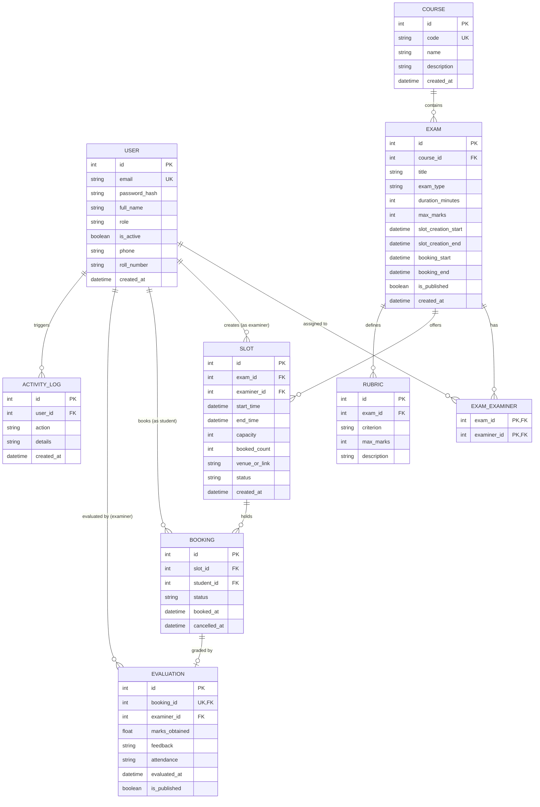

## PHASE 1: DESIGN ER DIAGRAM & ARCHITECTURE (Day 2–5)

> 💡 **Core Principle**: Do NOT write a single line of Flask code or database code before this is completely clear on paper.
> If the ER diagram is right, building the rest of the application is straightforward. If it is wrong, you will rewrite everything later.

---

## 🧠 Step 1.1 — Understand Users & Roles

The Examination Management Portal serves three distinct personas:

| Role | Description | Core Capabilities |
|---|---|---|
| **Admin** | System coordinator / Superuser | Creates courses, exams, and rubrics. Assigns examiners to exams. Sets slot-creation and booking date windows. Approves or deactivates examiners. Can reschedule bookings and change examiners. Has full search and audit log views. |
| **Examiner** | Faculty / Evaluation Staff | Registers account (requires Admin approval before login). Once assigned to an exam by Admin, creates exam slots within the exam's slot-creation window. Views student attendance lists for own slots. Evaluates students using rubrics and submits scores with remarks. |
| **Student** | Candidate / Examinee | Registers and logs in immediately. Searches and filters exams by course/type. Views available slots. Books one slot per exam without overlapping schedules. Cancels active bookings before slot starts. Views booking history and final published results. |

---

## 🗺️ Step 1.2 — Page Map

Every screen in the application corresponds to exactly one Flask route and one Jinja2 HTML template:

| Role | Page | URL | HTTP Method | Route Function | Template |
|---|---|---|---|---|---|
| **Public** | Home Page | `/` | GET | `auth.home` | `templates/home.html` |
| **Public** | Login | `/login` | GET, POST | `auth.login` | `templates/auth/login.html` |
| **Public** | Logout | `/logout` | GET | `auth.logout` | *(Redirects to home)* |
| **Public** | Register Student | `/register/student` | GET, POST | `auth.register_student` | `templates/auth/register_student.html` |
| **Public** | Register Examiner | `/register/examiner` | GET, POST | `auth.register_examiner` | `templates/auth/register_examiner.html` |
| **Admin** | Dashboard | `/admin/dashboard` | GET | `admin.dashboard` | `templates/admin/dashboard.html` |
| **Admin** | Course List | `/admin/courses` | GET | `admin.courses` | `templates/admin/courses.html` |
| **Admin** | Create Course | `/admin/courses/new` | GET, POST | `admin.course_new` | `templates/admin/course_form.html` |
| **Admin** | Edit Course | `/admin/courses/<id>/edit` | GET, POST | `admin.course_edit` | `templates/admin/course_form.html` |
| **Admin** | Delete Course | `/admin/courses/<id>/delete` | POST | `admin.course_delete` | *(Redirects)* |
| **Admin** | Exam List | `/admin/exams` | GET | `admin.exams` | `templates/admin/exams.html` |
| **Admin** | Create Exam | `/admin/exams/new` | GET, POST | `admin.exam_new` | `templates/admin/exam_form.html` |
| **Admin** | Edit Exam | `/admin/exams/<id>/edit` | GET, POST | `admin.exam_edit` | `templates/admin/exam_form.html` |
| **Admin** | Assign Examiners | `/admin/exams/<id>/examiners` | GET, POST | `admin.exam_examiners` | `templates/admin/exam_examiners.html` |
| **Admin** | Rubrics List | `/admin/rubrics` | GET | `admin.rubrics` | `templates/admin/rubrics.html` |
| **Admin** | Create Rubric | `/admin/rubrics/new` | GET, POST | `admin.rubric_new` | `templates/admin/rubric_form.html` |
| **Admin** | Edit Rubric | `/admin/rubrics/<id>/edit` | GET, POST | `admin.rubric_edit` | `templates/admin/rubric_form.html` |
| **Admin** | Delete Rubric | `/admin/rubrics/<id>/delete` | POST | `admin.rubric_delete` | *(Redirects)* |
| **Admin** | Examiners List | `/admin/examiners` | GET | `admin.examiners` | `templates/admin/examiners.html` |
| **Admin** | Approve Examiner | `/admin/examiners/<id>/approve` | POST | `admin.examiner_approve` | *(Redirects)* |
| **Admin** | Toggle Examiner | `/admin/examiners/<id>/toggle` | POST | `admin.examiner_toggle` | *(Redirects)* |
| **Admin** | Students List | `/admin/students` | GET | `admin.students` | `templates/admin/students.html` |
| **Admin** | Slots Oversight | `/admin/slots` | GET | `admin.slots` | `templates/admin/slots.html` |
| **Admin** | Bookings List | `/admin/bookings` | GET | `admin.bookings` | `templates/admin/bookings.html` |
| **Admin** | Reschedule Booking | `/admin/bookings/<id>/reschedule` | GET, POST | `admin.booking_reschedule` | `templates/admin/reschedule.html` |
| **Admin** | Cancel Booking | `/admin/bookings/<id>/cancel` | POST | `admin.booking_cancel` | *(Redirects)* |
| **Admin** | Search | `/admin/search` | GET | `admin.search` | `templates/admin/search.html` |
| **Admin** | History / Logs | `/admin/history` | GET | `admin.history` | `templates/admin/history.html` |
| **Examiner** | Dashboard | `/examiner/dashboard` | GET | `examiner.dashboard` | `templates/examiner/dashboard.html` |
| **Examiner** | Profile | `/examiner/profile` | GET, POST | `examiner.profile` | `templates/examiner/profile.html` |
| **Examiner** | Slots List | `/examiner/slots` | GET | `examiner.slots` | `templates/examiner/slots.html` |
| **Examiner** | Create Slot | `/examiner/slots/new` | GET, POST | `examiner.slot_new` | `templates/examiner/slot_form.html` |
| **Examiner** | Edit Slot | `/examiner/slots/<id>/edit` | GET, POST | `examiner.slot_edit` | `templates/examiner/slot_form.html` |
| **Examiner** | Delete Slot | `/examiner/slots/<id>/delete` | POST | `examiner.slot_delete` | *(Redirects)* |
| **Examiner** | Slot Attendees | `/examiner/slots/<id>/students` | GET | `examiner.slot_students` | `templates/examiner/slot_students.html` |
| **Examiner** | Evaluate Student | `/examiner/evaluate/<id>` | GET, POST | `examiner.evaluate` | `templates/examiner/evaluate.html` |
| **Student** | Dashboard | `/student/dashboard` | GET | `student.dashboard` | `templates/student/dashboard.html` |
| **Student** | Profile | `/student/profile` | GET, POST | `student.profile` | `templates/student/profile.html` |
| **Student** | Browse Exams | `/student/exams` | GET | `student.exams` | `templates/student/exams.html` |
| **Student** | Exam Slots | `/student/exams/<id>/slots` | GET | `student.exam_slots` | `templates/student/exam_slots.html` |
| **Student** | Book Slot | `/student/slots/<id>/book` | POST | `student.slot_book` | *(Redirects)* |
| **Student** | My Bookings | `/student/bookings` | GET | `student.bookings` | `templates/student/bookings.html` |
| **Student** | Cancel Booking | `/student/bookings/<id>/cancel` | POST | `student.booking_cancel` | *(Redirects)* |
| **Student** | History | `/student/history` | GET | `student.history` | `templates/student/history.html` |
| **Student** | Results | `/student/results` | GET | `student.results` | `templates/student/results.html` |

---

## 📊 Step 1.3 — Entity-Relationship (ER) Design

### 1. The Core Tables
1. **`User`**: Central identity table for authentication. Stores email, hashed password, role (`admin`, `examiner`, `student`), and status flags.
2. **`Course`**: Academic subjects (e.g., "MAD-1", "DBMS").
3. **`Exam`**: An examination tied to a Course with scheduling date windows (slot creation start/end and booking start/end).
4. **`exam_examiners`**: Association table mapping many-to-many relationship between Exams and assigned Examiners.
5. **`Slot`**: A specific time window (start/end) created by an Examiner for an Exam, with max capacity and booked counter.
6. **`Booking`**: Student reservation for a Slot. Unique constraint on student and exam prevents double-booking.
7. **`Rubric`**: Evaluation criteria and max marks defined for an Exam.
8. **`Evaluation`**: Examiner's grading of a student's booking, storing marks obtained, comments, attendance, and publication status.
9. **`ActivityLog`**: Immutable audit records for administrative tracking.

### 2. Mermaid ER Diagram



---

## 🎨 Step 1.4 — Wireframes & User Flows

### Admin Screen Flow
```
[Login] ──> [Admin Dashboard: Stats & Counts]
                 ├── Manage Courses (Create / Edit / Delete)
                 ├── Manage Exams (Create / Edit / Assign Examiners / Window Toggles)
                 ├── Manage Rubrics (Set criteria & max marks)
                 ├── Manage Examiners (Approve registrations / Deactivate)
                 ├── View All Slots & Bookings (Reschedule / Reassign Examiner)
                 └── Search & Activity Log Audit
```

### Examiner Screen Flow
```
[Register] ──> [Pending Approval State]
                       │ (Admin approves)
                       ▼
[Login] ──> [Examiner Dashboard]
                 ├── Assigned Exams Roster
                 ├── Create New Slot (Enforces exam slot-creation window & capacity)
                 ├── View Booked Students List
                 └── Evaluate Student (Input rubric marks, attendance, feedback)
```

### Student Screen Flow
```
[Register] ──> [Instant Active State]
                       │
                       ▼
[Login] ──> [Student Dashboard: Upcoming Exams & History]
                 ├── Browse & Filter Exams (Course filter, date filter, GET form)
                 ├── View Available Slots (Checks capacity > 0)
                 ├── Book Slot (Validates booking window, no overlap, 1 per exam)
                 ├── Cancel Active Booking
                 └── View Published Results & Feedback
```
